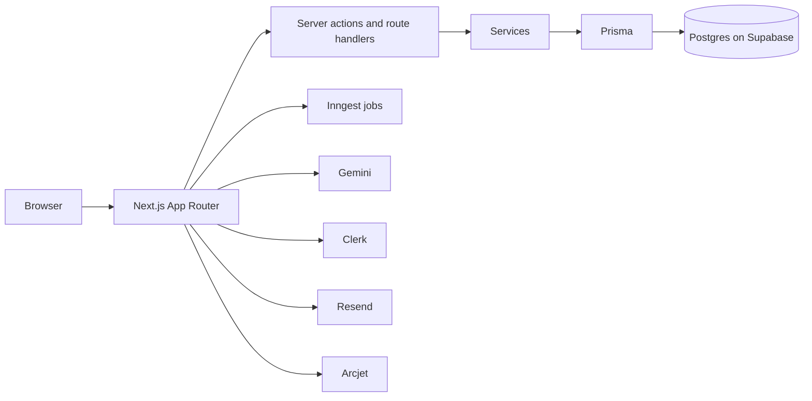

[](https://github.com/PrathamPeriwal/Ledgerly/actions/workflows/ci.yml)
[](LICENSE)
[](https://nextjs.org)

# Ledgerly

**Scan a receipt, review the draft, and see whether the month is still on pace.**

Ledgerly is a personal finance app: accounts, a monthly budget, and transactions you can type or scan. It is a portfolio project with a public demo ledger.

Live demo: https://ledgerly-finance-one.vercel.app (click TRY THE DEMO; sample data, no sign-up).

**Signature ideas.** Nothing from a scan is saved until you review it. One monthly budget covers every account, with a pace marker for the days left in the month.

Contents: [Features](#features) · [Architecture](#architecture) · [Background jobs](#background-jobs) · [Performance](#performance) · [Getting started](#getting-started) · [Scripts](#scripts) · [Testing](#testing) · [Security](#security) · [Deployment](#deployment) · [Roadmap](#roadmap) · [Notes](#notes)

## Features

- Receipt scanning with review: Gemini reads the image, and the form saves only after you confirm.
- Manual entry for anything a receipt does not cover.
- Multiple accounts, with one marked as the default.
- One monthly budget and a pace marker against the days left.
- Recurring transactions, posted by a daily job.
- A monthly email report.
- Privacy mode, which hides amounts in the browser.
- A command menu (Ctrl or Cmd+K) and a shortcut to add a transaction (N).
- Server-side search, filters, and pagination (15 rows per page).

## Architecture



### Key modules

| Path | Role |
| --- | --- |
| `app/` | Routes, layouts, and route handlers |
| `actions/` | Thin server actions |
| `lib/services/` | Writes and business rules |
| `lib/data/` | Reads for server components |
| `lib/validation/` | Zod schemas for forms and actions |
| `lib/auth/` | `requireUser()` and the Arcjet limit |
| `lib/inngest/` | Background jobs, served at `/api/inngest` |
| `lib/ai/` | Gemini client and model chain |
| `prisma/` | Schema and migrations |
| `components/` | Shared UI |

### Design decisions

| Decision | Why |
| --- | --- |
| SQL aggregation | Dashboard and account totals are grouped queries in Postgres, not rows summed in JavaScript |
| Atomic balances | The transaction row and the balance change share one `$transaction`, using increments |
| One monthly budget | One row per user (`budgets.userId` is unique), across accounts; pace reads that amount |
| Fan-out jobs | Cron functions only list the work; each item runs, and retries, on its own |
| `sin1` region | `vercel.json` pins functions to Singapore, next to the database |
| Security headers | `next.config.js` sets nosniff, a strict referrer policy, frame denial, and a camera-only permissions policy. No Content-Security-Policy, because Clerk and Next inline scripts |

Details: [docs/ARCHITECTURE.md](docs/ARCHITECTURE.md).

## Background jobs

Schedules are UTC. Defined in `lib/inngest/functions.ts`.

| Function | Schedule | Purpose |
| --- | --- | --- |
| `trigger-recurring-transactions` | `0 0 * * *` | Finds due templates and fans out one event each |
| `process-recurring-transaction` | event `transaction.recurring.process` | Posts one due template |
| `check-budget-alerts` | `0 */6 * * *` | Fans out one event per budget over its threshold |
| `process-budget-alert` | event `budget.alert.send` | Sends one budget alert |
| `generate-monthly-reports` | `0 0 1 * *` | Fans out one event per user with last month's transactions |
| `process-monthly-report` | event `report.monthly.send` | Sends one monthly report email |
| `demo-reset` | `0 20 * * *` | Restores the demo ledger, and keeps the free database from pausing |

## Performance

Load time for the demo user (Maya). Before is 21 Oct 2026; after is the Final table in [docs/PERF-BASELINE.md](docs/PERF-BASELINE.md) (v1.4.0, 27 Oct 2026).

| Route | Before | After |
| --- | ---: | ---: |
| `/` | 1,949 ms | 314 ms |
| `/dashboard` | 6,850 ms | 669 ms |
| default account | 4,512 ms | 581 ms |

Dashboard queries for Maya: 13 before, 6 after ([docs/PERF.md](docs/PERF.md)). Caveat: one machine, one location, median of three, production.

## Getting started

Prerequisites: Node.js 20 or newer, and PostgreSQL.

```bash
git clone https://github.com/PrathamPeriwal/Ledgerly.git && cd Ledgerly
npm install
cp .env.example .env
npx prisma migrate deploy
npm run dev
```

Open http://localhost:3000. Every variable is named in [docs/ENV.md](docs/ENV.md).

## Scripts

| Script | Purpose |
| --- | --- |
| `npm run check` | Lint, typecheck, and production build |
| `npm test` | Unit tests (Vitest) |
| `npm run test:e2e:quick` | Playwright: Maya's dashboard and her default account |
| `npm run check:seo` | Fetches HTML and checks the technical SEO tags |
| `npm run check:gemini` | Sends one short receipt request per configured model |
| `npm run seed:demo` | Dry run unless `--confirm`, which wipes transactions, budgets, accounts, and users |

## Testing

Unit tests cover validation, balance math, dashboard and account calculations, scan mapping, and the Gemini request shape. Integration tests use Postgres for demo users (balance changes, recurring templates, demo reset). Playwright covers demo sign-in plus Maya's dashboard and account page. CI (`.github/workflows/ci.yml`) runs lint, typecheck, and unit tests on pull requests and on pushes to `main`. End-to-end tests stay local because they need Clerk keys.

## Security

- Ownership is enforced in every query: services take `userId` and put it in the `where`.
- Server actions validate with Zod before they write.
- Arcjet covers middleware, and receipt scans are limited per user (10/hour), per IP (15/hour), and for the shared demo (6/hour).
- Security headers: nosniff, a strict referrer policy, frame denial, and a camera-only permissions policy.
- Secrets live only in environment variables. See [docs/ENV.md](docs/ENV.md).

## Deployment

The app is on Vercel in the Singapore region (`sin1`). Postgres is Supabase. Inngest Cloud calls `/api/inngest`.

The free database pauses when nothing talks to it. The nightly demo reset, a health ping every 3 days (`.github/workflows/keepalive.yml`), and ordinary use keep it awake.

## Roadmap

- Category budgets
- A production Clerk instance with a custom domain
- Dependency major upgrades
- CSV import and export

## Notes

Demo data is fictional. This is a portfolio project, not financial advice.

License: [MIT](LICENSE).
