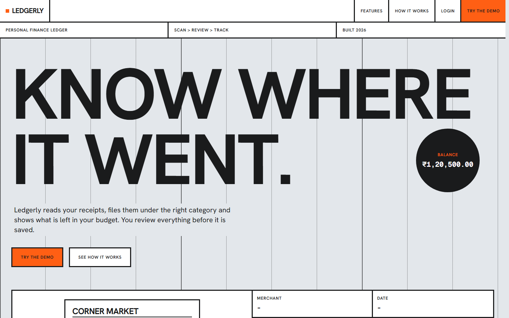
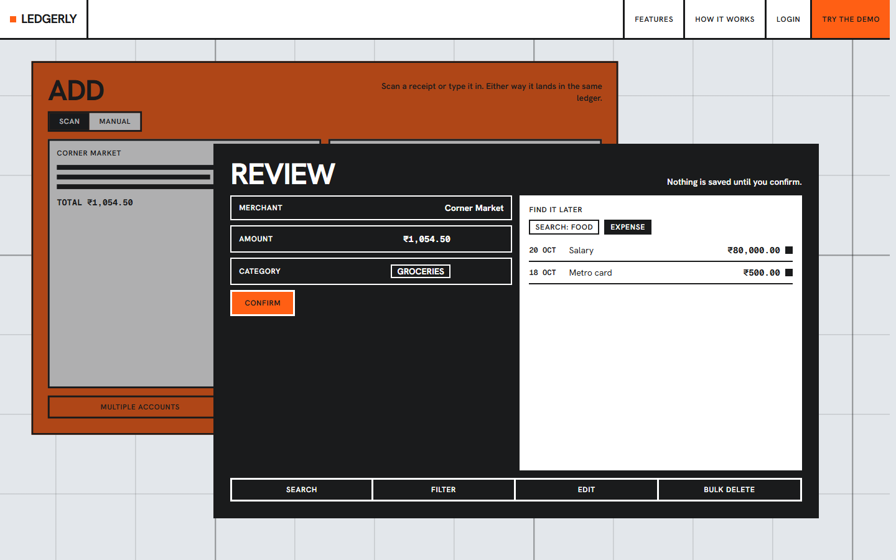
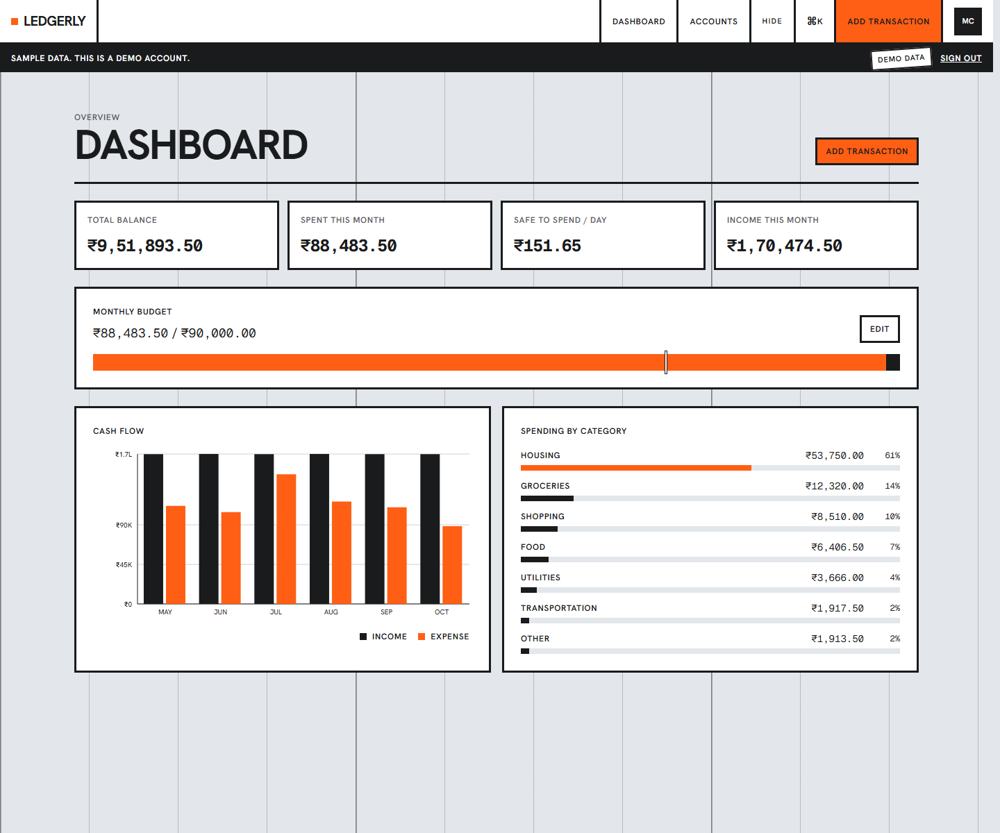
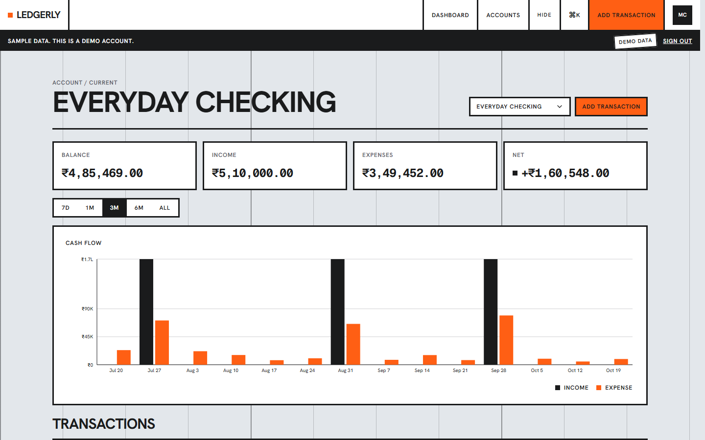
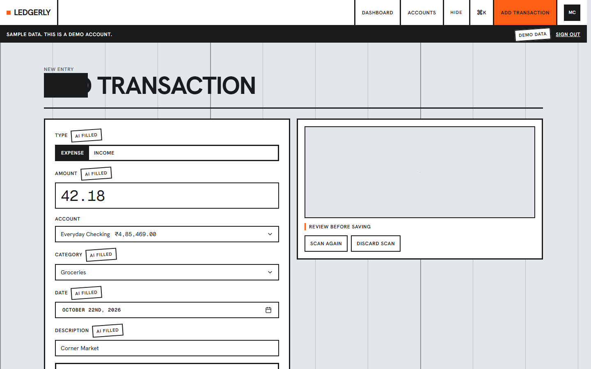
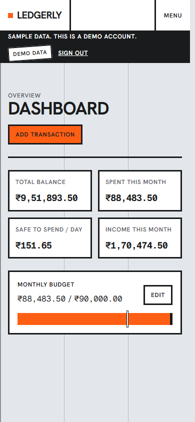

# Ledgerly

Scan receipts, review them, and see what is left in your budget.

## Live demo

https://ledgerly-finance-one.vercel.app

Click TRY THE DEMO to sign in with sample data; no sign-up needed.













## Features

- Receipt scanning with a review step before anything is saved
- Manual entry
- Multiple accounts
- One monthly budget with pace
- Recurring transactions
- Monthly email reports
- Privacy mode
- Command menu
- Server-side search, filter, and pagination

## Tech stack

Versions below are the ranges declared in `package.json`.

- Next.js 15.4.10, React 19, TypeScript 5.9
- Tailwind CSS 3.4
- Prisma 6 and Postgres
- Clerk 6
- Arcjet, Inngest 3, Google Gemini, Resend 4
- Motion 14
- Vitest 5 and Playwright 1.64

## How it works

1. Clerk handles sign-in. TRY THE DEMO asks `/api/demo-session` for a one-minute ticket and opens Maya's sample ledger.
2. A receipt image is sent to `/api/scan-receipt`. Gemini fills the form, and you can edit or discard it before save.
3. Accounts, transactions, and one budget per month are stored in Postgres through Prisma.
4. Inngest creates due recurring transactions and sends the monthly report with Resend.
5. The dashboard and each account page load on the server. Search, filters, and pages of 15 run in the query.

## Run locally

```bash
git clone https://github.com/PrathamPeriwal/Ledgerly.git
cd Ledgerly
npm install
cp .env.example .env
npx prisma migrate deploy
npm run dev
```

Open http://localhost:3000. Fill in `.env` first. See [docs/ENV.md](docs/ENV.md).

## Environment variables

[docs/ENV.md](docs/ENV.md)

## Scripts

| Script | What it does |
| --- | --- |
| `npm run check` | Lint, typecheck, and production build |
| `npm test` | Vitest |
| `npm run test:e2e:quick` | Playwright: Maya's dashboard and her default account. Fails on page errors or 5xx |
| `npm run seed:demo` | Resets demo data. **This wipes transactions, budgets, accounts, and users in the database** when you pass `--confirm`. It does not delete Clerk users. Default is a dry run |

## Testing

Unit tests are Vitest, under `tests/`. Browser tests are Playwright, under `e2e/`. `npm run test:e2e:quick` covers Maya only. `npm run verify` runs lint, Vitest, a production build, and `scripts/smoke.mjs`.

## Project structure

```
app/          pages, layouts, and route handlers
components/   shared UI
actions/      server actions
lib/          queries, Prisma, email, Inngest
prisma/       schema and migrations
emails/       monthly report
e2e/          Playwright
tests/        Vitest
docs/         environment notes and screenshots
```

## Roadmap

Backend performance and structure pass in progress.

## License

[MIT](LICENSE)
